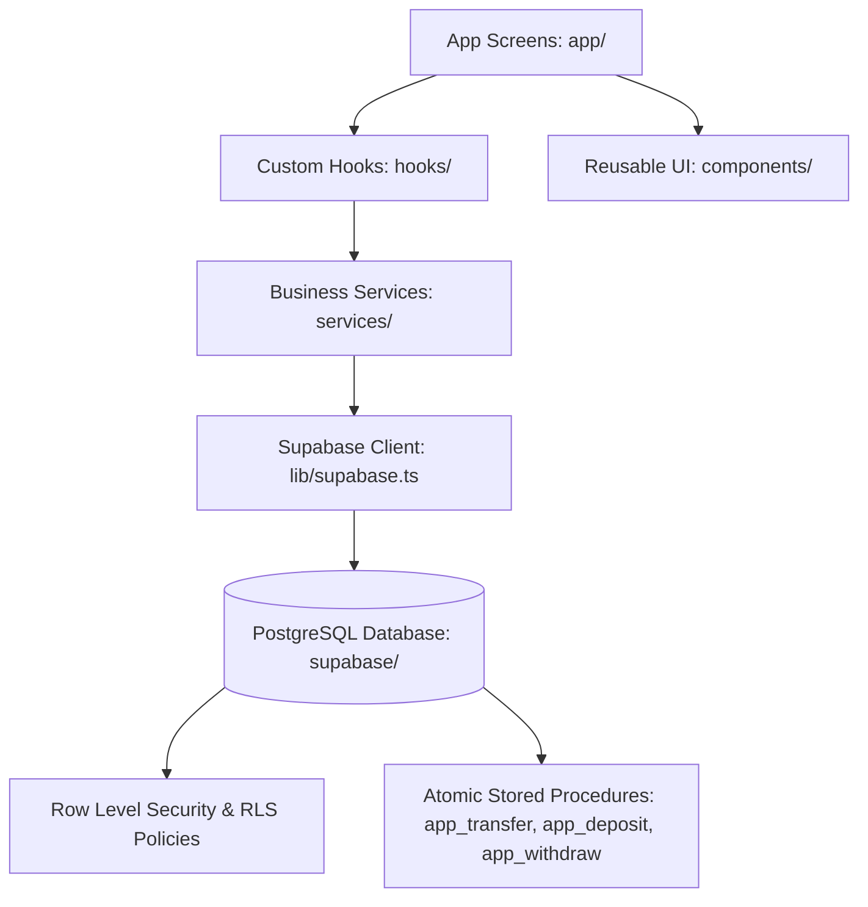

# SmartBank App - Complete Codebase & File Directory Guide

This document maps every file and directory in the project to its exact purpose, role, and architectural responsibility. Use this guide to quickly understand where features live and how data flows through the application.

---

## 🏛️ High-Level System Architecture

### Flow of Data:
1. **Screens (`app/`)**: Handle route parameters, screen layout, and user interaction.
2. **Hooks (`hooks/`)**: Cache state, handle subscriptions, and expose reactive data to screens.
3. **Services (`services/`)**: Make typed API calls and invoke atomic PostgreSQL functions via Supabase.
4. **Database (`supabase/`)**: Enforces Row Level Security (RLS) and handles ACID transactions (transfers, deposits, withdrawals) without exposing direct balance writes to the client.

---

## 📁 Root Configuration & Documentation

| File | Purpose & Responsibilities |
| :--- | :--- |
| **`package.json`** | Project manifest listing scripts (`npm start`, `npx expo start`, etc.) and dependencies (Expo, React Native, Supabase JS, React Native Safe Area, etc.). |
| **`tsconfig.json`** | TypeScript compiler configuration enabling strict typing, path aliases, and JSX preservation for React Native. |
| **`app.json`** | Expo application manifest defining app name, slug, splash screen, icons, scheme, and orientation settings. |
| **`.env`** | Local environment variables containing `EXPO_PUBLIC_SUPABASE_URL` and `EXPO_PUBLIC_SUPABASE_ANON_KEY`. |
| **`.env.example`** | Template file for required environment variables used during setup. |
| **`plan.md`** | Master implementation roadmap covering all 7 development phases, BR rules, and acceptance criteria. |
| **`design.md`** | Visual design system specification (emerald theme, typography, spacing, glassmorphic cards). |
| **`DESIGN_PROMPT.md`** | High-level UX/UI specifications and color palettes. |
| **`SmartBank_SRS_v2.1.docx`** | Software Requirements Specification (SRS v2.1) outlining business rules, roles, and compliance. |
| **`LICENSE`** | Project open-source software license. |

---

## 📱 Navigation & Screens (`app/`)

The application uses **Expo Router** (file-based routing). Folders with parentheses `(auth)`, `(customer)`, `(admin)` represent **route groups** that share layouts without affecting the URL path.

### 1. Root & Public Entry
| File | Route | Description |
| :--- | :--- | :--- |
| **`app/_layout.tsx`** | `/` | Root layout provider. Wraps the app in `SafeAreaProvider`, loads fonts, and manages top-level navigation. |
| **`app/index.tsx`** | `/` | Auth gate and splash redirector. Checks if the user is authenticated; routes admins to `/(admin)`, customers to `/(customer)`, or guests to `/(auth)/login`. |

---

### 2. Authentication Group (`app/(auth)/`)
| File | Route | Description |
| :--- | :--- | :--- |
| **`app/(auth)/_layout.tsx`** | `/(auth)` | Stack layout for authentication screens with smooth slide animations. |
| **`app/(auth)/login.tsx`** | `/(auth)/login` | Customer & Admin login screen. Validates email/password, signs in with Supabase, and checks role to direct users appropriately. |
| **`app/(auth)/register.tsx`** | `/(auth)/register` | Customer sign-up screen. Collects full name, phone number, national ID (NID), email, and password. Automatically creates their bank account upon submission. |
| **`app/(auth)/reset-password.tsx`** | `/(auth)/reset-password` | Password recovery screen. Sends password reset links via email. |

---

### 3. Customer Portal (`app/(customer)/`)
Protected by role gate in `app/(customer)/_layout.tsx` (only accessible to users with `role = 'customer'`).

#### Bottom Navigation Tabs (`app/(customer)/(tabs)/`)
| File | Tab Route | Description |
| :--- | :--- | :--- |
| **`app/(customer)/(tabs)/_layout.tsx`** | `/(customer)` | Bottom tab bar layout with active state styling, badges, and icons. |
| **`app/(customer)/(tabs)/index.tsx`** | `/(customer)` | **Customer Dashboard**. Shows total balance, account card, quick action buttons (Send Money, Cash Counter, Withdraw), and recent transactions list. |
| **`app/(customer)/(tabs)/transactions.tsx`** | `/(customer)/transactions` | **Transaction History**. Searchable, filterable list of all deposits, withdrawals, and transfers with date grouping and type pills. |
| **`app/(customer)/(tabs)/notifications.tsx`** | `/(customer)/notifications` | **Notifications Feed**. Displays transaction alerts and account notices with mark-as-read and unread count badges. |
| **`app/(customer)/(tabs)/profile.tsx`** | `/(customer)/profile` | **User Profile Screen**. Displays customer personal info, NID, assigned home branch, and sign-out button. |

#### Customer Stack Screens
| File | Route | Description |
| :--- | :--- | :--- |
| **`app/(customer)/_layout.tsx`** | `/(customer)` | Customer security guard. Redirects unauthenticated users to `/login` and admins to `/(admin)`. |
| **`app/(customer)/send-money.tsx`** | `/(customer)/send-money` | **Inter-Account Money Transfer**. Step-by-step transfer screen: recipient account lookup with name masking, balance check, amount validation, note input, and PIN/confirmation. |
| **`app/(customer)/withdraw.tsx`** | `/(customer)/withdraw` | **ATM / Counter Withdrawal**. Allows customers to withdraw money from their account with real-time balance checks. |
| **`app/(customer)/deposit.tsx`** | `/(customer)/deposit` | **Customer Deposit Guidance**. Explains physical cash counter deposit rules under SRS v2.1 and locates nearby branch counters. |
| **`app/(customer)/account.tsx`** | `/(customer)/account` | **Account Details View**. Detailed view of account number, IBAN/Routing number, current balance, and KYC status. |
| **`app/(customer)/transaction-details.tsx`** | `/(customer)/transaction-details` | **Transaction Receipt**. Displays complete receipt for a specific transaction (amount, reference ID, sender/recipient, timestamp, status). |

---

### 4. Admin & Teller Portal (`app/(admin)/`)
Protected by `app/(admin)/_layout.tsx` (strictly requires `role = 'admin'` or staff permissions).

#### Admin Bottom Tabs (`app/(admin)/(tabs)/`)
| File | Tab Route | Description |
| :--- | :--- | :--- |
| **`app/(admin)/(tabs)/_layout.tsx`** | `/(admin)` | Bottom tab bar layout for bank officers with custom admin glyphs. |
| **`app/(admin)/(tabs)/index.tsx`** | `/(admin)` | **Admin Dashboard**. Real-time metrics overview: total bank deposits, active accounts, daily transaction volume, and system health. |
| **`app/(admin)/(tabs)/users.tsx`** | `/(admin)/users` | **User Directory**. Searchable list of all registered bank customers with profile details and KYC statuses. |
| **`app/(admin)/(tabs)/deposit.tsx`** | `/(admin)/deposit` | **Cash Counter Deposit (Tab)**. Direct tab link to the teller cash counter deposit system. |
| **`app/(admin)/(tabs)/accounts.tsx`** | `/(admin)/accounts` | **Account Management**. List of all bank accounts. Allows admins to activate, deactivate, or block accounts with mandatory audit log reasons. Features direct **`Deposit 💵`** action buttons. |
| **`app/(admin)/(tabs)/branches.tsx`** | `/(admin)/branches` | **Branch Network (Tab)**. Tab link to view and manage bank branches and teller counter locations. |
| **`app/(admin)/(tabs)/transactions.tsx`** | `/(admin)/transactions` | **System-Wide Audit Ledger**. View and search all transactions across the entire bank with full audit details. |

#### Admin Stack Screens
| File | Route | Description |
| :--- | :--- | :--- |
| **`app/(admin)/_layout.tsx`** | `/(admin)` | Admin role guard. Redirects non-admins to `/(customer)` and unauthenticated users to `/login`. |
| **`app/(admin)/deposit.tsx`** | `/(admin)/deposit` | **Teller Cash Counter Deposit Screen**. Allows cash counter officers to take physical currency, lookup any customer account, verify customer identity, select branch, enter any deposit amount, and post instant credits. |
| **`app/(admin)/branches.tsx`** | `/(admin)/branches` | **Branch Management Screen**. Search and create physical bank branches (name, routing code, district, address). |
| **`app/(admin)/user-details.tsx`** | `/(admin)/user-details` | **Customer Details View**. Deep dive into a specific customer's profile, linked bank accounts, and transaction history. |

---

## 🎨 Reusable Components (`components/`)

Components are structured into logical domains to keep screens clean and reusable.

### Common (`components/common/`)
| Component | Description |
| :--- | :--- |
| **`Card.tsx`** | Reusable card container with border, subtle shadow, and consistent padding. |
| **`ConfirmDialog.tsx`** | Modal dialog for sensitive actions (e.g., blocking an account, confirming big transfers). |
| **`EmptyState.tsx`** | Friendly placeholder UI shown when lists have no items (e.g., "No transactions yet"). |
| **`ErrorState.tsx`** | Error banner with retry button for failed network requests. |
| **`LoadingState.tsx`** | Standard activity indicator and message for asynchronous loading. |
| **`Money.tsx`** | Currency formatter component that renders Bangladesh Taka (`৳`) with proper typography and coloring. |
| **`ScreenHeader.tsx`** | Standardized screen header with title, subtitle, and optional back navigation. |

### Authentication (`components/auth/`)
| Component | Description |
| :--- | :--- |
| **`AuthButton.tsx`** | Primary and secondary action button with loading spinner and disabled states. |
| **`AuthInput.tsx`** | Form text input with label, validation error feedback, and secure password toggle. |
| **`FormErrorBanner.tsx`** | Red alert banner displayed at the top of forms when submission fails. |
| **`FormSuccessBanner.tsx`** | Green alert banner displayed upon successful password resets or submissions. |
| **`ScreenContainer.tsx`** | Responsive container wrapping auth views with keyboard avoidance and scrolling. |

### Banking (`components/banking/`)
| Component | Description |
| :--- | :--- |
| **`AccountCard.tsx`** | Premium card displaying masked account number, balance, status badge, and copy button. |
| **`BalanceCard.tsx`** | Hero balance display with currency symbol and eye toggle to hide/show balance. |
| **`NotificationRow.tsx`** | Row item in notification list with unread indicator and timestamp. |
| **`QuickActions.tsx`** | Row of quick action shortcuts (Send Money, Cash Deposit, Withdraw, Statement). |
| **`TransactionRow.tsx`** | Row item representing a transaction with icon, counterparty name, amount, and date. |
| **`TransactionTypePill.tsx`** | Color-coded status badge for transaction types (`Deposit`, `Transfer`, `Withdrawal`). |

### Admin (`components/admin/`)
| Component | Description |
| :--- | :--- |
| **`AccountRow.tsx`** | Admin row for an account showing holder name, branch, status, and status toggle buttons. |
| **`StatCard.tsx`** | Dashboard metrics card showing key numbers (total accounts, volume, revenue) with trend badges. |
| **`UserRow.tsx`** | Admin customer list item showing full name, email, phone, and registration date. |

---

## ⚡ Custom React Hooks (`hooks/`)

Hooks encapsulate asynchronous state, data fetching, and real-time synchronization.

| Hook | Responsibility |
| :--- | :--- |
| **`useSession.ts`** | Manages Supabase Auth session state and subscribes to `onAuthStateChange` events. |
| **`useProfile.ts`** | Fetches the current user's profile (`full_name`, `role`, `kyc_status`) and provides an `isAdmin()` helper. |
| **`useAccount.ts`** | Loads the customer's primary bank account, real-time balance, and account status (`active`, `blocked`). |
| **`useTransactions.ts`** | Fetches paginated transaction records with support for filtering by type and status. |
| **`useNotifications.ts`** | Fetches user notifications, manages unread counts, and provides a `markAsRead` function. |

---

## 🛠️ Business Services (`services/`)

Services contain pure business logic and talk directly to Supabase.

| Service | Key Functions & Responsibilities |
| :--- | :--- |
| **`services/auth.ts`** | `signInWithPassword()`, `signUp()`, `signOut()`, `sendPasswordResetEmail()`. Handles session persistence. |
| **`services/profiles.ts`** | `getCurrentProfile()`, `updateProfile()`. Retrieves and updates user profile data. |
| **`services/accounts.ts`** | `getPrimaryAccount()`, `lookupRecipient(accountNumber)`. Looks up recipient details and validates recipient eligibility for transfers. |
| **`services/transactions.ts`** | `executeTransfer()`, `executeWithdrawal()`, `listTransactions()`, `getTransactionById()`. Calls Postgres stored procedures for atomic financial operations. |
| **`services/admin.ts`** | `getAdminDashboardMetrics()`, `listUsers()`, `listAccounts()`, `adminSetAccountStatus()`, `recordBranchDeposit()`. Powers admin queries, audits, and teller cash deposits. |
| **`services/branches.ts`** | `listActiveBranches()`, `createBranch()`. Manages physical branch metadata. |
| **`services/notifications.ts`** | `listNotifications()`, `markNotificationRead()`, `markAllNotificationsRead()`. Manages user alert records. |

---

## 🌐 Supabase Client, Constants & Utilities

| File | Purpose |
| :--- | :--- |
| **`lib/supabase.ts`** | Configures the `@supabase/supabase-js` client using environment variables and sets up AsyncStorage for auth session token persistence. |
| **`constants/colors.ts`** | Design system color palette (Emerald green primary, dark background, surfaces, borders, status colors). |
| **`constants/layout.ts`** | Spacing units (`xs`, `sm`, `md`, `lg`, `xl`), typography scales, and border radiuses. |
| **`constants/routes.ts`** | Strongly typed route paths and URL builder helpers (`transactionDetailsPath`, `adminUserDetailsPath`, `adminDepositPath`). |
| **`types/db.ts`** | Comprehensive TypeScript types matching the database schema (`Profile`, `Account`, `Transaction`, `Branch`, `Notification`, `AuditLog`, etc.). |
| **`utils/format.ts`** | Formatting helpers: `formatBDT()` (currency formatting), `formatDateTime()`, `maskAccountNumber()`, and `isValidBankingAmount()`. |
| **`utils/validation.ts`** | Input validators: email validation, Bangladeshi phone number validation, password strength, and account number regex. |

---

## 🗄️ Database & Migrations (`supabase/`)

The backend is powered by PostgreSQL inside Supabase, utilizing strict Row Level Security (RLS) and stored procedures (RPC) for atomic operations.

| File | Migration / Script Purpose |
| :--- | :--- |
| **`supabase/migrations/0001_schema.sql`** | Creates all core tables: `profiles`, `branches`, `accounts`, `transactions`, `notifications`, `audit_logs`, and custom enum types (`account_status`, `transaction_type`, etc.). |
| **`supabase/migrations/0002_rls.sql`** | Configures Row-Level Security (RLS) policies: ensures customers only read their own accounts and transactions while staff can manage records. |
| **`supabase/migrations/0003_functions.sql`** | Defines atomic PL/pgSQL stored procedures: `app_transfer` (atomic balance debit/credit), `app_withdraw`, `app_deposit`, and unique account number generator (`generate_account_number`). |
| **`supabase/migrations/0004_triggers.sql`** | Sets up triggers for automatic `updated_at` timestamps, notification generation on transaction events, and audit logging. |
| **`supabase/migrations/0005_seed_admin.sql`** | Seed migration to provision initial staff roles and administrator privileges. |
| **`supabase/migrations/0006_fix_missing_profiles.sql`** | Trigger that automatically provisions a `public.profiles` row and default active bank account whenever a user registers in `auth.users`. |
| **`supabase/migrations/0007_srs_v2_alignment.sql`** | Aligns database to SRS v2.1: implements `lookup_recipient` RPC, teller deposit validations, branch association, and anti-tampering balance checks. |
| **`supabase/seed.sql`** | Demo seed data including branches across Bangladesh districts and sample testing accounts. |
| **`supabase/create_admin.sql`** | Helper SQL script to elevate existing users to `admin` role. |
| **`supabase/README.md`** | Setup instructions and guidance for running Supabase migrations locally or in the Supabase Cloud Dashboard. |

---

## 🖼️ Static Assets (`assets/`)

| File | Description |
| :--- | :--- |
| **`assets/icon.png`** | Main mobile app launcher icon. |
| **`assets/splash-icon.png`** | Loading screen splash image. |
| **`assets/favicon.png`** | Web favicon for browser previews. |
| **`assets/android-icon-foreground.png`** | Android adaptive icon foreground layer. |
| **`assets/android-icon-background.png`** | Android adaptive icon background layer. |
| **`assets/android-icon-monochrome.png`** | Android themed monochrome icon layer. |

---

## 💡 Quick Reference: Where Do I Change...?

- **To modify colors or styling**: Check `constants/colors.ts` and `constants/layout.ts`.
- **To add or modify routes**: Update `constants/routes.ts` and create files inside `app/`.
- **To change transfer or deposit business logic**: Edit `services/transactions.ts` and `services/admin.ts`, and update the corresponding PostgreSQL function in `supabase/migrations/0003_functions.sql` / `0007_srs_v2_alignment.sql`.
- **To change how accounts look**: Update `components/banking/AccountCard.tsx` or `components/admin/AccountRow.tsx`.
- **To update validation rules**: Adjust `utils/validation.ts`.
