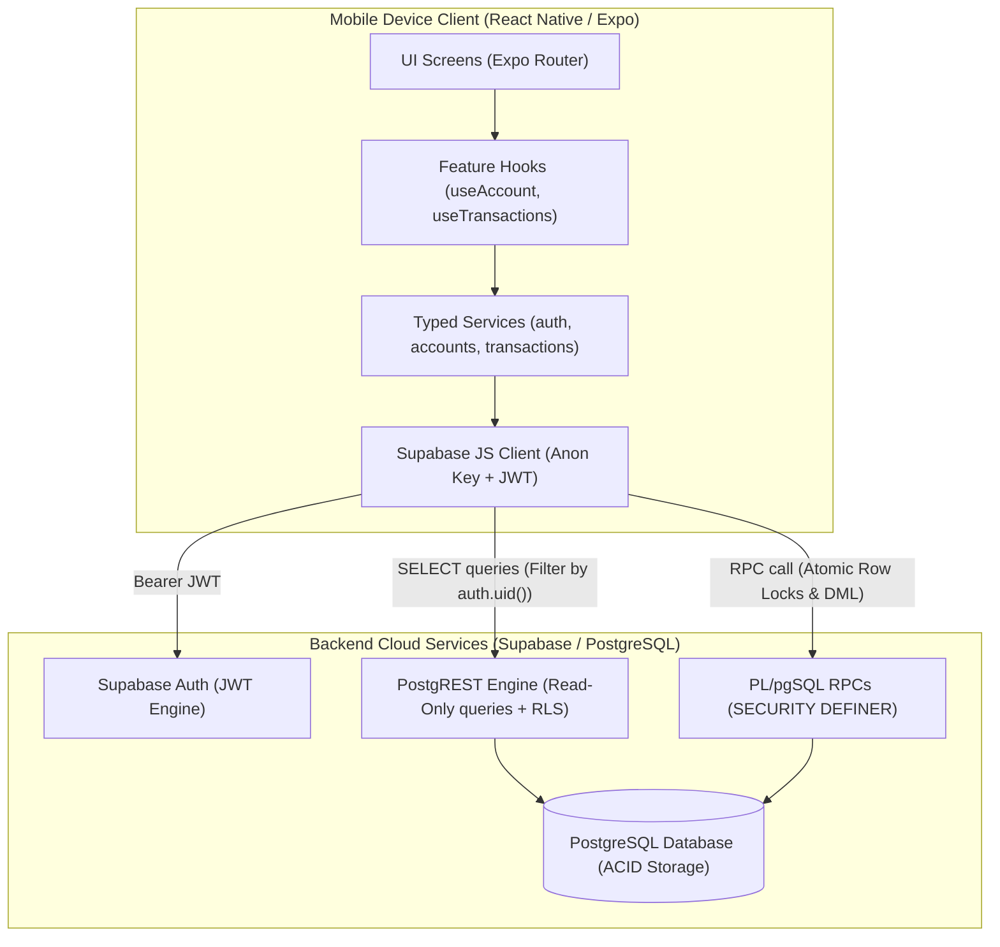
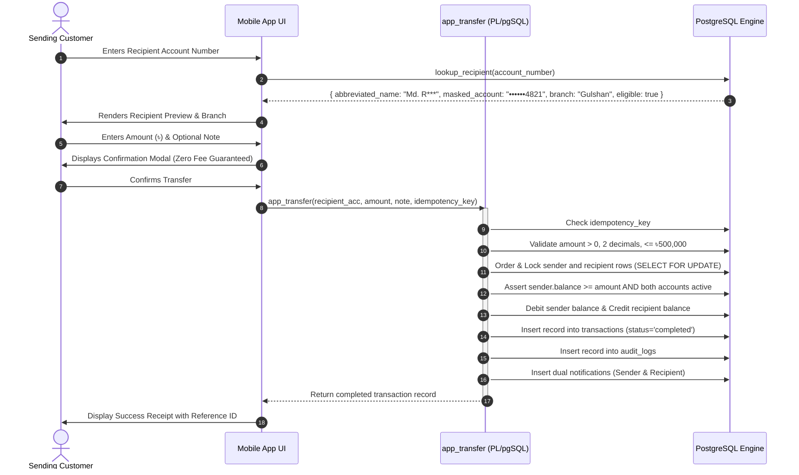
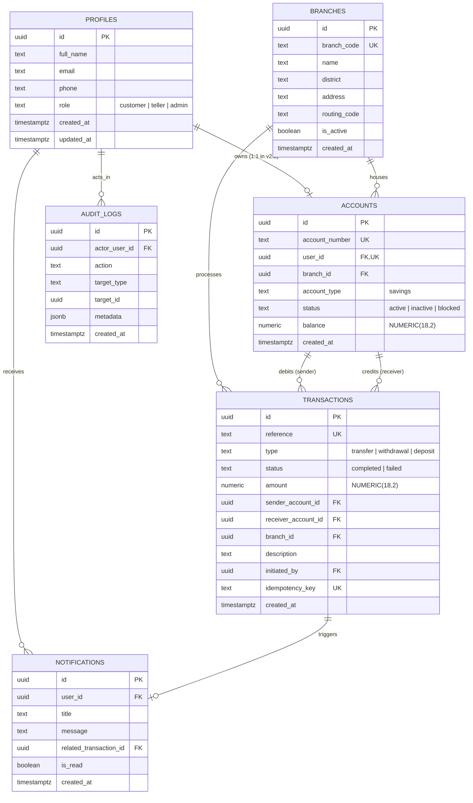

# Software Requirements Specification (SRS)
# SmartBank — Digital Banking Simulation Platform

**Document Identifier:** SRS-SMARTBANK-V2.2  
**Standard Compliance:** ISO/IEC/IEEE 29148:2018 / IEEE 830-1998  
**Project:** University App Development Project  
**Target Release:** Version 2.2 (Realistic Money Flow, Branch-Aware Transfers & Teller Counter Operations)  
**Date of Specification:** November 2026  
**Status:** Approved & Implemented  
**Technology Stack:** React Native (Expo v57) · TypeScript 6.0 · Supabase (PostgreSQL 15+, RLS, PL/pgSQL RPCs)  
**Currency Standard:** Bangladeshi Taka (৳ BDT) — Fixed-Precision `NUMERIC(18,2)`  

---

## Document Control & Revision History

| Version | Date | Author / Role | Summary of Changes |
| :--- | :--- | :--- | :--- |
| **1.0.0** | Sep 2026 | App Dev Team | Initial prototype specification with direct customer deposit and single-table ledger. |
| **2.0.0** | Oct 2026 | Architecture Team | Removed arbitrary customer self-deposits; introduced branch-aware P2P transfers. |
| **2.1.0** | Oct 2026 | Systems Auditor | Standardized on zero transfer fees (BR-06/07); single authoritative balance with row-locking RPCs; recipient enumeration protection via abbreviated names (FR-TRF-02); added formal test traceability (TC-01..TC-23). |
| **2.2.0** | Nov 2026 | Lead Architect | Codebase-synchronized specification reflecting full implementation: dual-tab teller cash counter deposits, dedicated branch network management, audit log inspection, multi-step transfer validation, and graceful database migration fallbacks. |

---

## Table of Contents

1. [Introduction](#1-introduction)
   - 1.1 Purpose
   - 1.2 Document Conventions
   - 1.3 Intended Audience
   - 1.4 Product Scope & Educational Boundary
   - 1.5 References
2. [Overall Description](#2-overall-description)
   - 2.1 Product Perspective & Context
   - 2.2 High-Level System Architecture
   - 2.3 User Classes & Personas
   - 2.4 Operating Environment
   - 2.5 Design & Implementation Constraints
   - 2.6 Assumptions and Dependencies
3. [External Interface Requirements](#3-external-interface-requirements)
   - 3.1 User Interfaces & Screen Flow Hierarchy
   - 3.2 Visual Design System & Styling Rules
   - 3.3 Hardware Interfaces
   - 3.4 Software & Backend Interfaces
   - 3.5 Communications Protocols
4. [System Features & Functional Requirements](#4-system-features--functional-requirements)
   - 4.1 Authentication & Session Management (`FR-AUTH`)
   - 4.2 Customer Profile & PII Protection (`FR-PROF`)
   - 4.3 Branch Network Management (`FR-BR`)
   - 4.4 Account Lifecycle & Status Governance (`FR-ACC`)
   - 4.5 Branch-Aware Peer-to-Peer Transfers (`FR-TRF`)
   - 4.6 Simulated ATM / Counter Cash Withdrawals (`FR-WD`)
   - 4.7 Staff Branch Cash Counter Deposits (`FR-DEP`)
   - 4.8 Transaction Ledger & Digital Receipts (`FR-TXN`)
   - 4.9 Real-Time In-App Notification Engine (`FR-NOT`)
   - 4.10 Administrative Oversight & Audit Trails (`FR-ADM`)
5. [Data Requirements & Schema Specifications](#5-data-requirements--schema-specifications)
   - 5.1 Entity-Relationship Model
   - 5.2 Data Dictionary (Tables & Constraints)
   - 5.3 PostgreSQL Enums & Types
   - 5.4 Row Level Security (RLS) Policy Matrix
   - 5.5 Stored Procedures & Atomic RPC Contracts
6. [Non-Functional Requirements](#6-non-functional-requirements)
   - 6.1 Security & Access Control (`NFR-SEC`)
   - 6.2 Transactional Integrity & Concurrency (`NFR-INT`)
   - 6.3 Reliability, Idempotency & Fault Recovery (`NFR-REL`)
   - 6.4 Usability & Accessibility (`NFR-USE`)
   - 6.5 Performance & Responsiveness (`NFR-PERF`)
   - 6.6 Maintainability & Modularity (`NFR-MAINT`)
   - 6.7 Educational Simulation Integrity (`NFR-ENV`)
7. [Business Rules Matrix](#7-business-rules-matrix)
8. [Acceptance Criteria & Test Matrix](#8-acceptance-criteria--test-matrix)
9. [Traceability Matrix](#9-traceability-matrix)

---

## 1. Introduction

### 1.1 Purpose
This Software Requirements Specification (SRS) provides a definitive, complete, and verifiable description of the **SmartBank** digital banking simulation application. It establishes the authoritative baseline for software engineers, Quality Assurance (QA) testers, UI/UX designers, and academic evaluators. It specifies functional workflows, data models, Row Level Security (RLS) policies, atomic stored procedures, and verification criteria.

### 1.2 Document Conventions
- Requirements are classified using unique identifiers: `FR-[CAT]-[NUM]` for functional requirements, `NFR-[CAT]-[NUM]` for non-functional requirements, `BR-[NUM]` for business rules, and `TC-[NUM]` for test cases.
- In accordance with RFC 2119, keywords are interpreted as follows:
  - **SHALL**: Indicates an absolute, mandatory technical requirement.
  - **SHOULD**: Indicates a strongly recommended practice that may have valid architectural exceptions.
  - **MAY**: Indicates an optional extension or configurable feature.

### 1.3 Intended Audience
- **Frontend Engineers**: For implementing React Native screens, state hooks, and validation layers.
- **Backend Engineers & DBAs**: For maintaining PostgreSQL migrations, RLS policies, and PL/pgSQL RPCs.
- **QA & Verification Testers**: For developing automated and manual test suites mapped to the acceptance criteria.
- **Project Supervisors / Evaluators**: For assessing software engineering rigor, architectural partitioning, and compliance with simulated financial requirements.

### 1.4 Product Scope & Educational Boundary
SmartBank is an educational digital banking simulation platform engineered for mobile devices. The application simulates the core retail banking domain:
- Automated account issuance upon customer registration.
- Branch association across major districts in Bangladesh.
- Internal Peer-to-Peer (P2P) fund transfers with anti-enumeration recipient lookup.
- Simulated ATM / branch counter cash withdrawals.
- Teller-assisted physical cash counter deposits.
- Real-time notification distribution and immutable audit trails.

> [!CAUTION]
> **Educational Simulation Boundary:** SmartBank is strictly an educational prototype. It does not connect to Bangladesh Electronic Funds Transfer Network (BEFTN), National Payment Switch Bangladesh (NPSB), Real-Time Gross Settlement (RTGS), Mobile Financial Services (bKash/Nagad), automated clearing houses, or card networks. No real monetary value is held, transferred, or processed. All test balances and branches constitute demonstration data.

### 1.5 References
1. IEEE Std 830-1998: *IEEE Recommended Practice for Software Requirements Specifications*.
2. ISO/IEC/IEEE 29148:2018: *Systems and software engineering — Life cycle processes — Requirements engineering*.
3. SmartBank Technical Design Specification (`design.md`).
4. SmartBank Project Roadmap & Implementation Plan (`plan.md`).
5. SmartBank Directory & Architectural Guide (`PROJECT_STRUCTURE.md`).

---

## 2. Overall Description

### 2.1 Product Perspective & Context
SmartBank operates as a client-server distributed system where a cross-platform mobile client communicates over secure HTTPS and WebSockets with a managed Supabase backend hosting a PostgreSQL database.

### 2.2 System Architecture Principles
1. **Zero-Trust Client Boundary:** The mobile client is untrusted. The application never performs direct balance updates (`UPDATE accounts SET balance = ...`) or direct transaction writes from the client.
2. **Atomic Financial Transactions:** All balance-modifying events (transfers, withdrawals, deposits) execute exclusively inside PostgreSQL stored procedures configured with `SECURITY DEFINER`. Operations occur within a single ACID transaction block (`BEGIN ... COMMIT`) utilizing strict pessimistic row locks (`SELECT ... FOR UPDATE`).
3. **Deadlock-Resistant Concurrency:** Whenever two accounts are locked concurrently (e.g., sender and recipient in a transfer), row locks are acquired in consistent sorted order by UUID (`min(sender_id, recipient_id)` followed by `max(sender_id, recipient_id)`).
4. **Guaranteed Idempotency:** Every financial operation requires a unique client-generated UUID idempotency key (`p_idempotency_key`). Retried requests resulting from packet drops or user double-clicks immediately return the previously committed transaction record without executing secondary mutations.
5. **Fixed-Point Financial Precision:** All currency amounts are stored and computed using `NUMERIC(18,2)`. IEEE-754 floating-point representations are prohibited across the database schema and service layers.

### 2.3 User Classes & Personas

| Role Name | System Code | Persona & Responsibilities |
| :--- | :--- | :--- |
| **Retail Customer** | `customer` | An authenticated individual who holds one personal Savings account. Authorized to view account balances, review transaction statements, execute P2P transfers, simulate cash withdrawals, and manage profile contacts. Cannot alter balances directly or record cash deposits. |
| **Authorized Branch Teller** | `teller` | A banking operational staff member situated at a physical branch. Authorized to search customer accounts, verify customer identification at the counter, confirm simulated cash intake, and record branch cash deposits. |
| **System Administrator** | `admin` | A privileged supervisory user. Holds all teller capabilities plus overall system management: toggling account status (`active`, `inactive`, `blocked`) with mandatory audit logging, provisioning bank branches, monitoring system-wide ledgers, and reviewing security audit logs. |

### 2.4 Operating Environment
- **Client Platforms:** Android 8.0+ (API Level 26+) primary; iOS 15.0+ compatible; Modern Web (Chromium/Safari) for evaluation previews.
- **Client Runtime:** React Native 0.86.3 with Expo SDK 57, React 19.2.3, and Expo Router 57 (file-based navigation).
- **Backend Infrastructure:** Supabase Managed Cloud or Self-Hosted Docker deployment running PostgreSQL 15.x.
- **Network Environment:** TLS 1.3 encrypted HTTPS for PostgREST/RPC APIs; Secure WSS for Realtime event channels.

### 2.5 Design & Implementation Constraints
- **CON-01 (Single Account Rule):** In Version 2.2, each customer is constrained to exactly one personal Savings account (`accounts.user_id` enforced by unique index `one_account_per_user`).
- **CON-02 (Key Security):** Under no circumstance shall the Supabase `service_role` key be bundled, referenced, or exposed within client bundles. Only the public `anon` key is permitted on client devices.
- **CON-03 (Display Standards):** Currency is rendered using the Bengali Rupee/Taka symbol (`৳`), formatted with standard digit grouping (`৳1,234.50`) and tabular numeric typography.

---

## 3. External Interface Requirements

### 3.1 User Interfaces & Screen Flow Hierarchy

```mermaid
graph TD
    Splash["app/index.tsx (Auth & Role Gate)"]
    
    subgraph AuthGroup["Auth Portal (app/(auth)/)"]
        Login["login.tsx"]
        Register["register.tsx"]
        ResetPass["reset-password.tsx"]
    end

    subgraph CustomerGroup["Customer Portal (app/(customer)/)"]
        CustTabs["(tabs)/_layout.tsx"]
        CustDash["(tabs)/index.tsx (Dashboard)"]
        CustTxns["(tabs)/transactions.tsx (History)"]
        CustNotifs["(tabs)/notifications.tsx (Alerts)"]
        CustProfile["(tabs)/profile.tsx (Profile)"]
        SendMoney["send-money.tsx (P2P Transfer)"]
        Withdraw["withdraw.tsx (ATM Simulation)"]
        CustDeposit["deposit.tsx (Branch Counter Notice)"]
        AccountView["account.tsx (Account Details)"]
        Receipt["transaction-details.tsx (Receipt)"]
    end

    subgraph AdminGroup["Staff & Admin Portal (app/(admin)/)"]
        AdminTabs["(tabs)/_layout.tsx"]
        AdminDash["(tabs)/index.tsx (Metrics Overview)"]
        AdminUsers["(tabs)/users.tsx (Customer Directory)"]
        AdminAccounts["(tabs)/accounts.tsx (Account Management)"]
        AdminDepositTab["(tabs)/deposit.tsx (Teller Cash Counter)"]
        AdminBranchesTab["(tabs)/branches.tsx (Branch Network)"]
        AdminTxns["(tabs)/transactions.tsx (Audit Ledger)"]
        AdminDeposit["deposit.tsx (Dedicated Teller Deposit)"]
        AdminBranches["branches.tsx (Branch Creator/Editor)"]
        UserDetails["user-details.tsx (Deep Audit)"]
    end

    Splash -->|"Unauthenticated"| Login
    Splash -->|"role = customer"| CustDash
    Splash -->|"role in admin/teller"| AdminDash

    Login --- Register
    Login --- ResetPass

    CustDash --> SendMoney
    CustDash --> Withdraw
    CustDash --> CustDeposit
    CustDash --> AccountView
    CustTxns --> Receipt

    AdminAccounts --> AdminDeposit
    AdminUsers --> UserDetails
```

### 3.2 Visual Design System & Styling Rules
- **Color Hierarchy:**
  - `Primary / Emerald Accent`: `#059669` (Dark), `#10B981` (Bright Brand Accent).
  - `Background Canvas`: `#090D16` (Deep Midnight Black).
  - `Surface Cards & Modals`: `#111827` (Charcoal Surface) with `#1F2937` borders.
  - `Semantic Feedback`: Success `#10B981`, Error `#EF4444`, Warning `#F59E0B`, Informational `#3B82F6`.
- **Form Controls:** Touch targets maintain a minimum dimension of $48 \times 48\text{ dp}$. Secure fields provide visible eye toggles for masked password text. Form submissions disable interactive buttons and display inline loading spinners.

### 3.3 Software & Backend Interfaces
- **Supabase Auth API:** Manages credential verification, session token issuance, and password recovery triggers via standard REST endpoints.
- **PostgREST Database API:** Serves read queries against `profiles`, `branches`, `accounts`, `transactions`, `notifications`, and `audit_logs`, bounded strictly by active session JWT and PostgreSQL Row Level Security.
- **Supabase Realtime API:** PostgreSQL CDC (Change Data Capture) via WebSocket channels:
  - `account:{account_id}`: Subscribes customers to real-time balance updates.
  - `txns:{account_id}`: Broadcasts newly posted transaction records.

---

## 4. System Features & Functional Requirements

### 4.1 Authentication & Session Management (`FR-AUTH`)

| ID | Requirement Description |
| :--- | :--- |
| **FR-AUTH-01** | The system **SHALL** allow new users to register by providing Full Name, Phone Number, Email, Password, and home branch selection. |
| **FR-AUTH-02** | The system **SHALL** automatically assign the `customer` role to any publicly registered user via a server-side trigger. Public clients **SHALL NOT** have the ability to assign `admin` or `teller` roles. |
| **FR-AUTH-03** | The system **SHALL** authenticate customers and staff using email and password credentials, returning an encrypted JWT access token upon success. |
| **FR-AUTH-04** | The system **SHALL** provide a password reset workflow triggering a verification link to the user's registered email address. |
| **FR-AUTH-05** | The system **SHALL** terminate user sessions on request, invalidating local tokens stored in AsyncStorage and clearing reactive subscriptions. |

### 4.2 Customer Profile & PII Protection (`FR-PROF`)

| ID | Requirement Description |
| :--- | :--- |
| **FR-PROF-01** | Customers **SHALL** be able to view their personal profile information, including Full Name, Email, Phone Number, Assigned Branch, and Account Number. |
| **FR-PROF-02** | Customers **SHALL** be permitted to update only non-financial contact information (`full_name`, `phone`). |
| **FR-PROF-03** | Customers **SHALL NOT** be permitted to edit or inject values for `role`, `balance`, `account_number`, or `status`. Database RLS and column-level guards **SHALL** reject any client attempts to alter these fields. |

### 4.3 Branch Network Management (`FR-BR`)

| ID | Requirement Description |
| :--- | :--- |
| **FR-BR-01** | The system **SHALL** maintain physical branch records containing `branch_code`, `name`, `district`, `address`, `routing_code`, and `is_active` status. |
| **FR-BR-02** | The system **SHALL** provide a seeded list of realistic branches across Bangladesh districts (e.g., Dhaka Motijheel, Gulshan, Chittagong Agrabad, Sylhet Zindabazar, Rajshahi, Khulna, Barishal, Bogura). |
| **FR-BR-03** | Authenticated users **SHALL** have read-only access to active branch listings. Branch creation and modifications **SHALL** be restricted exclusively to users holding the `admin` role. |

### 4.4 Account Lifecycle & Status Governance (`FR-ACC`)

| ID | Requirement Description |
| :--- | :--- |
| **FR-ACC-01** | Upon successful registration, the system **SHALL** automatically provision a unique 12-character alphanumeric bank account number (`generate_account_number()`) linked to the customer's profile and selected branch. |
| **FR-ACC-02** | In the current release, the system **SHALL** enforce exactly one personal Savings account per registered user. |
| **FR-ACC-03** | Each account **SHALL** have an explicit operational status: `active`, `inactive`, or `blocked`. |
| **FR-ACC-04** | Accounts in `inactive` or `blocked` status **SHALL** be strictly prohibited from sending transfers, receiving transfers, withdrawing funds, or receiving counter deposits. |
| **FR-ACC-05** | Only administrators **SHALL** have permission to update account statuses (`admin_set_account_status`). Every status transition **SHALL** record a mandatory justification string in `audit_logs`. |

### 4.5 Branch-Aware Peer-to-Peer Transfers (`FR-TRF`)

| ID | Requirement Description |
| :--- | :--- |
| **FR-TRF-01** | The customer **SHALL** initiate an internal transfer by providing the destination SmartBank account number. |
| **FR-TRF-02** | Prior to transfer confirmation, the backend **SHALL** execute `lookup_recipient()` to return verified preview details: abbreviated name (e.g., `Md. R***`), masked account number (`••••••4821`), account type, branch name, district, and eligibility status. The full legal name **SHALL NEVER** be disclosed. |
| **FR-TRF-03** | Self-transfers (where recipient account number matches the sender's own account) **SHALL** be immediately rejected with error code `self_transfer`. |
| **FR-TRF-04** | The transfer amount **SHALL** be a positive numeric value with at most two decimal places, not exceeding the maximum per-transaction threshold of ৳500,000.00. |
| **FR-TRF-05** | The backend **SHALL** enforce that sender balance is greater than or equal to the requested transfer amount. Deficits **SHALL** raise an `insufficient_balance` exception. |
| **FR-TRF-06** | Transfers **SHALL** incur a fee of exactly ৳0.00 in Version 2.2. The exact amount debited from the sender **SHALL** equal the amount credited to the recipient. |
| **FR-TRF-07** | Transfers **SHALL** be processed atomically inside `app_transfer()`. Any failure at any point **SHALL** roll back the entire transaction block without partial balance adjustments. |
| **FR-TRF-08** | Every successful transfer **SHALL** generate a unique human-readable reference formatted as `TXN-YYYYMMDD-XXXXXXXX`. |
| **FR-TRF-09** | Every transfer submission **SHALL** include a client UUID `idempotency_key`. Redundant requests replaying the same key **SHALL** return the previously created transaction record without re-executing balance mutations. |

### 4.6 Simulated ATM / Counter Cash Withdrawals (`FR-WD`)

| ID | Requirement Description |
| :--- | :--- |
| **FR-WD-01** | An active customer **SHALL** be permitted to request a simulated cash withdrawal from their primary savings account via `app_withdraw()`. |
| **FR-WD-02** | The withdrawal screen **SHALL** display a prominent, unambiguous disclaimer stating: *"Simulated cash withdrawal for educational purposes. No physical cash will be dispensed."* |
| **FR-WD-03** | The withdrawal amount **SHALL** be validated against positive numeric constraints, two decimal places, per-transaction limits, and available account balance. |
| **FR-WD-04** | A successful withdrawal **SHALL** atomically debit the customer's balance, insert a completed transaction row of type `withdrawal` (`receiver_account_id = NULL`), record an entry in `audit_logs`, and generate an in-app notification. |

### 4.7 Staff Branch Cash Counter Deposits (`FR-DEP`)

| ID | Requirement Description |
| :--- | :--- |
| **FR-DEP-01** | The application **SHALL NOT** provide any customer-facing self-deposit feature. Customers **SHALL NOT** possess the ability to increment their own balance by inputting an arbitrary number. |
| **FR-DEP-02** | If a customer navigates to the customer deposit screen, the UI **SHALL** inform them of the branch counter policy and direct them to their assigned home branch counter. |
| **FR-DEP-03** | Branch cash deposits **SHALL** be performed exclusively by authorized operational staff holding the `teller` or `admin` role via `app_deposit()`. |
| **FR-DEP-04** | The teller deposit interface **SHALL** require the operator to select the receiving branch, look up and verify the target customer account, input the cash amount, confirm physical receipt of simulated currency, and provide an optional operator note. |
| **FR-DEP-05** | Upon execution, `app_deposit()` **SHALL** verify caller permissions, lock the target account, credit the balance, insert a completed `deposit` transaction row (`sender_account_id = NULL`), write a security audit record referencing the teller, and dispatch a real-time notification to the beneficiary account owner. |

### 4.8 Transaction Ledger & Digital Receipts (`FR-TXN`)

| ID | Requirement Description |
| :--- | :--- |
| **FR-TXN-01** | Customers **SHALL** be restricted to viewing transaction records where their account serves as either the sender (`sender_account_id`) or recipient (`receiver_account_id`). |
| **FR-TXN-02** | The transaction history list **SHALL** provide real-time filtering by transaction category (`transfer`, `withdrawal`, `deposit`). |
| **FR-TXN-03** | Every transaction entry **SHALL** allow navigation to a detailed digital receipt screen rendering: Unique Reference Code, Timestamp, Status Pill, Amount in BDT (`৳`), Counterparty Details, Receiving Branch, Description Note, and Idempotency Signature. |
| **FR-TXN-04** | Transaction ledger records **SHALL** be immutable. The system **SHALL NOT** provide any endpoint or interface to modify or delete committed transaction rows. |

### 4.9 Real-Time In-App Notification Engine (`FR-NOT`)

| ID | Requirement Description |
| :--- | :--- |
| **FR-NOT-01** | The database layer **SHALL** automatically create notification entries whenever a financial event occurs (incoming transfer, outgoing transfer, cash withdrawal, or teller deposit). |
| **FR-NOT-02** | Customers **SHALL** view an in-app notifications feed with unread indicators, formatted timestamps, and references to associated transactions (`related_transaction_id`). |
| **FR-NOT-03** | Customers **SHALL** have the ability to mark individual notifications or all notifications as read. |

### 4.10 Administrative Oversight & Audit Trails (`FR-ADM`)

| ID | Requirement Description |
| :--- | :--- |
| **FR-ADM-01** | Administrators **SHALL** have access to a centralized dashboard presenting aggregate statistics: Total Registered Users, Total Accounts, Total Active Accounts, System-wide Transaction Volume, and Total Branches. |
| **FR-ADM-02** | Administrators **SHALL** be able to search and inspect all registered user profiles and drill down into linked accounts and transaction histories. |
| **FR-ADM-03** | Administrators **SHALL** have authority to toggle account states (`active`, `inactive`, `blocked`). The system **SHALL** reject any status modification that lacks a documented reason. |
| **FR-ADM-04** | Administrators **SHALL** have access to an immutable system-wide audit log viewer (`audit_logs`) capturing actor IDs, timestamps, target entities, and JSON metadata. |
| **FR-ADM-05** | Staff roles (`admin`, `teller`) **SHALL** be provisionable solely through database migration seeds or administrative server-side execution. |

---

## 5. Data Requirements & Schema Specifications

### 5.1 Entity-Relationship Model

### 5.2 Data Dictionary (Tables & Constraints)

#### 1. `profiles`
Represents user identities synchronized with `auth.users`.
- `id` (`UUID`, Primary Key, References `auth.users(id)` ON DELETE CASCADE).
- `full_name` (`TEXT`, NOT NULL): Full legal customer name.
- `email` (`TEXT`, NOT NULL): Registered email address.
- `phone` (`TEXT`, NULL): Mobile phone number.
- `role` (`TEXT`, NOT NULL, DEFAULT `'customer'`): Constraint: `role IN ('customer', 'teller', 'admin')`.
- `created_at` (`TIMESTAMPTZ`, DEFAULT `now()`).
- `updated_at` (`TIMESTAMPTZ`, DEFAULT `now()`).

#### 2. `branches`
Represents physical bank branches across Bangladesh districts.
- `id` (`UUID`, Primary Key, DEFAULT `gen_random_uuid()`).
- `branch_code` (`TEXT`, UNIQUE, NOT NULL): E.g., `'BR-DHK-001'`.
- `name` (`TEXT`, NOT NULL): E.g., `'Dhaka Motijheel Main Branch'`.
- `district` (`TEXT`, NOT NULL): E.g., `'Dhaka'`, `'Chittagong'`, `'Sylhet'`.
- `address` (`TEXT`, NULL): Physical street address.
- `routing_code` (`TEXT`, NULL): Informational bank routing identifier.
- `is_active` (`BOOLEAN`, NOT NULL, DEFAULT `true`).
- `created_at` (`TIMESTAMPTZ`, DEFAULT `now()`).

#### 3. `accounts`
Core financial account balance store.
- `id` (`UUID`, Primary Key, DEFAULT `gen_random_uuid()`).
- `account_number` (`TEXT`, UNIQUE, NOT NULL): 12-char formatted number (e.g., `'AC1000000001'`).
- `user_id` (`UUID`, UNIQUE, NOT NULL, References `profiles(id)`): One account per user constraint.
- `branch_id` (`UUID`, NOT NULL, References `branches(id)`).
- `account_type` (`TEXT`, NOT NULL, DEFAULT `'savings'`): Constraint: `account_type IN ('savings')`.
- `status` (`TEXT`, NOT NULL, DEFAULT `'active'`): Constraint: `status IN ('active', 'inactive', 'blocked')`.
- `balance` (`NUMERIC(18,2)`, NOT NULL, DEFAULT `0.00`): Constraint: `balance >= 0`.
- `created_at` (`TIMESTAMPTZ`, DEFAULT `now()`).

#### 4. `transactions`
Immutable financial activity ledger.
- `id` (`UUID`, Primary Key, DEFAULT `gen_random_uuid()`).
- `reference` (`TEXT`, UNIQUE, NOT NULL): Reference ID (e.g., `'TXN-20261118-A1B2C3D4'`).
- `type` (`TEXT`, NOT NULL): Constraint: `type IN ('transfer', 'withdrawal', 'deposit')`.
- `transaction_type` (`TEXT`, NOT NULL): Mirror column for backwards compatibility.
- `status` (`TEXT`, NOT NULL, DEFAULT `'completed'`): Constraint: `status IN ('completed', 'failed')`.
- `amount` (`NUMERIC(18,2)`, NOT NULL): Constraint: `amount > 0`.
- `sender_account_id` (`UUID`, NULL, References `accounts(id)`): NULL for cash deposit.
- `receiver_account_id` (`UUID`, NULL, References `accounts(id)`): NULL for cash withdrawal.
- `branch_id` (`UUID`, NULL, References `branches(id)`).
- `description` (`TEXT`, NULL): Purpose or memo note.
- `initiated_by` (`UUID`, NOT NULL, References `profiles(id)`).
- `idempotency_key` (`TEXT`, UNIQUE WHERE NOT NULL): Client-side UUID.
- `created_at` (`TIMESTAMPTZ`, DEFAULT `now()`).

#### 5. `notifications`
Customer alert queue.
- `id` (`UUID`, Primary Key, DEFAULT `gen_random_uuid()`).
- `user_id` (`UUID`, NOT NULL, References `profiles(id)`).
- `title` (`TEXT`, NOT NULL): Short alert header.
- `message` (`TEXT`, NOT NULL): Descriptive notification content.
- `related_transaction_id` (`UUID`, NULL, References `transactions(id)`).
- `is_read` (`BOOLEAN`, NOT NULL, DEFAULT `false`).
- `created_at` (`TIMESTAMPTZ`, DEFAULT `now()`).

#### 6. `audit_logs`
System-wide security and operations log.
- `id` (`UUID`, Primary Key, DEFAULT `gen_random_uuid()`).
- `actor_user_id` (`UUID`, NULL, References `profiles(id)`).
- `action` (`TEXT`, NOT NULL): E.g., `'transfer'`, `'withdrawal'`, `'deposit'`, `'account.status_change'`.
- `target_type` (`TEXT`, NULL): E.g., `'account'`, `'transaction'`.
- `target_id` (`UUID`, NULL).
- `metadata` (`JSONB`, NULL): Structured context (amounts, before/after values, reasons).
- `created_at` (`TIMESTAMPTZ`, DEFAULT `now()`).

### 5.3 Row Level Security (RLS) Policy Matrix

| Table | Operation | Target Role | Enforced Security Rule / Predicate |
| :--- | :--- | :--- | :--- |
| `profiles` | `SELECT` | `authenticated` | `id = auth.uid() OR is_admin()` |
| `profiles` | `UPDATE` | `authenticated` | `id = auth.uid()` (Guarded against role changes) |
| `branches` | `SELECT` | `authenticated` | `auth.uid() IS NOT NULL` (All authenticated users) |
| `branches` | `INSERT / UPDATE` | `authenticated` | `is_admin()` |
| `accounts` | `SELECT` | `authenticated` | `user_id = auth.uid() OR is_admin()` |
| `accounts` | `INSERT / UPDATE` | **DENIED** | **No public policies.** Mutations locked to `SECURITY DEFINER` RPCs. |
| `transactions` | `SELECT` | `authenticated` | `is_admin() OR sender_account_id IN (SELECT id FROM accounts WHERE user_id = auth.uid()) OR receiver_account_id IN (SELECT id FROM accounts WHERE user_id = auth.uid())` |
| `transactions` | `INSERT / UPDATE` | **DENIED** | **No public policies.** Insertions locked to `SECURITY DEFINER` RPCs. |
| `notifications` | `SELECT` | `authenticated` | `user_id = auth.uid()` |
| `notifications` | `UPDATE` | `authenticated` | `user_id = auth.uid()` (Used exclusively to toggle `is_read`) |
| `audit_logs` | `SELECT` | `authenticated` | `is_admin()` |
| `audit_logs` | `INSERT / UPDATE` | **DENIED** | Writes executed exclusively by trusted server-side procedures. |

### 5.4 Stored Procedures & Atomic RPC Contracts

#### 1. `lookup_recipient(p_account_number TEXT) -> JSONB`
- **Security:** `SECURITY DEFINER`, search path `public`.
- **Functionality:** Resolves target account number.
- **Return Object:** `{ account_number, masked_account_number, abbreviated_name, account_type, branch_name, district, status, eligible }`.
- **PII Guard:** Masks name to abbreviated initial format (`Md. R***`) and hides middle digits of account number (`••••••4821`).

#### 2. `app_transfer(p_recipient_account_number, p_amount, p_description, p_idempotency_key) -> transactions`
- **Security:** `SECURITY DEFINER`, search path `public`.
- **Validation:** Amount > 0, max 2 decimals, <= ৳500,000; sender and recipient accounts active; self-transfer prohibited; sender balance >= amount.
- **Locking:** `SELECT ... FOR UPDATE` acquired in lexicographical order of account UUIDs.
- **Mutations:** Debits sender, credits recipient, inserts `transactions` record, inserts `audit_logs` record, generates dual `notifications`.

#### 3. `app_withdraw(p_amount, p_idempotency_key) -> transactions`
- **Security:** `SECURITY DEFINER`, search path `public`.
- **Validation:** Amount > 0, max 2 decimals, within balance, account active.
- **Mutations:** Debits caller account, inserts `withdrawal` record (`receiver_account_id = NULL`), inserts `audit_logs`, generates notification.

#### 4. `app_deposit(p_target_account_number, p_branch_id, p_amount, p_reference_note, p_idempotency_key) -> transactions`
- **Security:** `SECURITY DEFINER`, search path `public`.
- **Authorization:** Caller `role IN ('teller', 'admin')`.
- **Validation:** Receiving branch active; target account active; amount valid.
- **Mutations:** Credits target account, inserts `deposit` record (`sender_account_id = NULL`), inserts `audit_logs`, generates notification to customer.

#### 5. `admin_set_account_status(p_account_id, p_status, p_reason) -> accounts`
- **Security:** `SECURITY DEFINER`, search path `public`.
- **Authorization:** Caller `is_admin() = true`.
- **Mutations:** Updates `accounts.status`, inserts `audit_logs` capturing previous status, new status, and mandatory reason.

---

## 6. Non-Functional Requirements

### 6.1 Security & Access Control (`NFR-SEC`)
- **NFR-SEC-01 (Database Isolation):** Row Level Security (RLS) **SHALL** be activated across all database tables. No customer query shall be capable of viewing another user's balance, account number, or transaction details.
- **NFR-SEC-02 (Anti-Harvesting / Enumeration Protection):** The recipient lookup endpoint **SHALL NOT** disclose full legal names. Names **SHALL** be sanitized to abbreviated strings (`Md. R***`).
- **NFR-SEC-03 (Token Integrity):** All authenticated client calls **SHALL** transmit an unexpired Supabase JWT over HTTPS.
- **NFR-SEC-04 (Credential Segregation):** The Supabase `service_role` key **SHALL NEVER** be compiled into or distributed with the client binary.

### 6.2 Transactional Integrity & Concurrency (`NFR-INT`)
- **NFR-INT-01 (ACID Guarantees):** Every financial balance adjustment **SHALL** execute within an atomic transaction. Partial commits (such as debiting a sender without crediting a receiver) are architecturally impossible.
- **NFR-INT-02 (Pessimistic Concurrency):** RPCs modifying balances **SHALL** acquire row-level locks (`FOR UPDATE`) to serialize concurrent requests and eliminate race conditions.
- **NFR-INT-03 (Deadlock Prevention):** Multi-account locks **SHALL** be acquired in deterministic UUID order.

### 6.3 Reliability, Idempotency & Fault Recovery (`NFR-REL`)
- **NFR-REL-01 (Idempotent API Retries):** Retried transactions bearing an identical `idempotency_key` **SHALL** return the original transaction receipt without re-executing balance debits or credits.
- **NFR-REL-02 (Client Resilience):** Network timeouts and packet drops **SHALL** display informative user recovery prompts with retry capabilities that preserve the active idempotency key.

### 6.4 Usability & Accessibility (`NFR-USE`)
- **NFR-USE-01 (Clarity of Financial Feedback):** Error messages **SHALL** provide unambiguous, human-friendly guidance (e.g., *"You don't have enough balance for this transfer."* instead of raw SQL error strings).
- **NFR-USE-02 (Accessibility & Contrast):** High contrast ratios compliant with WCAG 2.1 AA standards **SHALL** be maintained across all screens. Interactive buttons **SHALL** provide minimum touch boundaries of $48\text{ dp}$.
- **NFR-USE-03 (Currency Standards):** All currency displays **SHALL** render Bangladesh Taka (`৳`) with strict two-decimal formatting and standard comma digit separation.

### 6.5 Performance & Responsiveness (`NFR-PERF`)
- **NFR-PERF-01 (UI Responsiveness):** All asynchronous operations (data fetching, RPC execution) **SHALL** present visible loading states within 100 ms of user initiation.
- **NFR-PERF-02 (Transaction Execution Latency):** Server-side RPC execution for transfers and deposits **SHALL** complete within 500 ms under standard database operating conditions.

### 6.6 Maintainability & Modularity (`NFR-MAINT`)
- **NFR-MAINT-01 (Layered Separation of Concerns):** The codebase **SHALL** adhere to a strict tiered architecture: UI Screens (`app/`) $\rightarrow$ Custom Reactive Hooks (`hooks/`) $\rightarrow$ Typed Business Services (`services/`) $\rightarrow$ Client Library (`lib/supabase.ts`) $\rightarrow$ Database Stored Procedures (`supabase/`).
- **NFR-MAINT-02 (Strict Typing):** TypeScript strict mode **SHALL** be enforced without implicit `any` definitions across core banking domains.

### 6.7 Educational Simulation Integrity (`NFR-ENV`)
- **NFR-ENV-01 (Demonstration Transparency):** The user interface and accompanying documentation **SHALL** prominently indicate that SmartBank is an educational simulation. Test accounts and balances **SHALL NOT** represent real monetary holdings.

---

## 7. Business Rules Matrix

| Rule ID | Rule Summary | Business Definition & Enforcement Mechanism |
| :--- | :--- | :--- |
| **BR-01** | **No Customer Self-Deposit** | Customers cannot arbitrarily type an amount to increase their balance. The customer deposit screen is restricted to an informational notice. All deposits require an authorized branch teller (`app_deposit`). |
| **BR-02** | **Internal Transfers Only** | Fund transfers are restricted to valid accounts within SmartBank. Inter-bank or third-party transfers are excluded. |
| **BR-03** | **Branch-Aware Lookup** | Destination accounts must be validated against `lookup_recipient()`, returning masked account details, abbreviated name, and branch district prior to submission. |
| **BR-04** | **Strict Account Eligibility** | Both sender and recipient accounts must hold `status = 'active'`. Inactive or blocked accounts cannot participate in any transaction. |
| **BR-05** | **Balance Sufficiency** | Senders must maintain available funds $\ge$ transfer/withdrawal amount. Negative balances are rejected by database check constraint `balance >= 0`. |
| **BR-06** | **Zero Transfer Fee** | P2P transfers incur no fee. Debited sender amount precisely equals credited recipient amount. |
| **BR-07** | **Fixed-Precision Money** | Money is stored as `NUMERIC(18,2)`. Amounts with greater than two decimal places or negative values are rejected. |
| **BR-08** | **Operation Idempotency** | Every balance-altering action requires a client-generated UUID key to prevent duplicate processing during retries. |
| **BR-09** | **Audit Trail Immutability** | Financial transactions and audit logs are append-only. No application role possesses privileges to delete or modify historical records. |
| **BR-10** | **Staff-Verified Deposit** | Cash deposits require physical cash confirmation by an authorized teller, linking the transaction to an active physical branch. |
| **BR-11** | **Simulation Transparency** | All accounts, balances, and branches represent simulated educational demonstration data. |
| **BR-12** | **Single Account per Customer** | Each customer owns exactly one personal Savings account. Transfers to the sender's own account are prohibited (`self_transfer`). |

---

## 8. Acceptance Criteria & Test Matrix

| Test ID | Test Scenario | Execution Step | Expected Verification Result |
| :--- | :--- | :--- | :--- |
| **TC-01** | Valid Customer Login | Customer enters valid email and password on `/login`. | User authenticated; navigated to `/(customer)` dashboard. |
| **TC-02** | Customer Cross-Account Read | Authenticated Customer A queries Customer B's account row via PostgREST. | PostgreSQL RLS denies read; 0 rows returned. |
| **TC-03** | Successful P2P Transfer | Customer enters valid recipient account and amount within balance. | Sender debited, recipient credited; transaction reference and dual notifications created atomically. |
| **TC-04** | Transfer Exceeds Balance | Sender attempts transfer of ৳10,000 with ৳5,000 balance. | RPC throws `insufficient_balance`; neither balance changes. |
| **TC-05** | Recipient Lookup Not Found | User enters non-existent account number `'AC9999999999'`. | UI displays *"No SmartBank account found for that number."*; transfer prevented. |
| **TC-06** | Blocked Account Transfer | Sender attempts transfer to an account marked `status = 'blocked'`. | RPC raises `recipient_inactive`; transaction aborted. |
| **TC-07** | Self-Transfer Attempt | Customer attempts transfer to their own account number. | Rejected by UI and backend with `self_transfer` error code. |
| **TC-08** | Concurrent Transfers | Two transfers submitted simultaneously from an account with funds for only one. | First transfer succeeds; second fails with `insufficient_balance` due to row-level locks. |
| **TC-09** | Client Direct Balance Write | Client sends direct PostgREST `PATCH /accounts` updating `balance`. | Request rejected with RLS permission denied error. |
| **TC-10** | Customer Self-Deposit Attempt | Client invokes deprecated `deposit_funds()` RPC. | Throws `customer_deposit_disabled` exception. |
| **TC-11** | Staff Branch Cash Deposit | Teller selects branch, target account, and submits cash deposit. | Target account credited; deposit transaction and audit record committed atomically. |
| **TC-12** | Unauthorized Deposit Attempt | Customer client attempts to call `app_deposit()`. | Throws `not_authorized`; caller role is not `teller` or `admin`. |
| **TC-13** | Network Error Idempotency | Client replays `app_transfer` with identical `idempotency_key` after network drop. | Initial transaction receipt returned; balance debited only once. |
| **TC-14** | Transaction History Isolation | Customer reviews transaction history. | Only transactions where user is sender or recipient are displayed. |
| **TC-15** | Admin Account Status Change | Administrator updates account status to `blocked` with reason. | Status updated; audit log entry recorded with actor ID, reason, and before/after states. |
| **TC-16** | Simulated Cash Withdrawal | Customer submits withdrawal of ৳1,000 with sufficient funds. | Balance debited by ৳1,000; disclaimer shown; notification dispatched. |
| **TC-17** | Withdrawal Exceeds Balance | Customer attempts withdrawal exceeding available balance. | Throws `insufficient_balance`; account balance remains unchanged. |
| **TC-18** | Customer Profile Update | Customer updates phone number. Attempts to inject `role = 'admin'`. | Phone updated; role remains `customer`; client cannot elevate role. |
| **TC-19** | Password Reset Flow | User inputs registered email on `/reset-password`. | Supabase triggers password reset email dispatch. |
| **TC-20** | Incoming Transfer Alert | Customer receives transfer from peer. | New unread notification appears; toggling marks as read. |
| **TC-21** | Recipient PII Minimization | Sender looks up recipient `'AC1000000002'`. | Returns abbreviated name (`Md. R***`) and masked account (`••••••0002`); full legal name withheld. |
| **TC-22** | Public Role Elevation Guard | User submits registration payload with `role: 'admin'`. | Trigger overrides payload; profile created with `role = 'customer'`. |
| **TC-23** | Invalid Amount Formats | User enters negative amount (`-50`), zero (`0`), or 3 decimals (`10.555`). | Client and server validation reject payload prior to transaction processing. |

---

## 9. Traceability Matrix

| Requirement ID | Architectural Component | Database Entity / RPC | Test Case ID |
| :--- | :--- | :--- | :--- |
| **FR-AUTH-01 .. 05** | `app/(auth)/`, `services/auth.ts` | `auth.users`, `handle_new_user()` | TC-01, TC-19, TC-22 |
| **FR-PROF-01 .. 03** | `app/(customer)/(tabs)/profile.tsx`, `services/profiles.ts` | `public.profiles` | TC-18 |
| **FR-BR-01 .. 03** | `app/(admin)/branches.tsx`, `services/branches.ts` | `public.branches` | TC-11 |
| **FR-ACC-01 .. 05** | `app/(customer)/account.tsx`, `services/accounts.ts` | `public.accounts`, `admin_set_account_status` | TC-02, TC-09, TC-15 |
| **FR-TRF-01 .. 09** | `app/(customer)/send-money.tsx`, `services/transactions.ts` | `app_transfer()`, `lookup_recipient()` | TC-03, TC-04, TC-05, TC-06, TC-07, TC-08, TC-13, TC-21, TC-23 |
| **FR-WD-01 .. 06** | `app/(customer)/withdraw.tsx`, `services/transactions.ts` | `app_withdraw()` | TC-16, TC-17 |
| **FR-DEP-01 .. 08** | `app/(admin)/deposit.tsx`, `services/admin.ts` | `app_deposit()`, `deposit_funds()` | TC-10, TC-11, TC-12 |
| **FR-TXN-01 .. 05** | `app/(customer)/(tabs)/transactions.tsx`, `services/transactions.ts` | `public.transactions` | TC-14 |
| **FR-NOT-01 .. 03** | `app/(customer)/(tabs)/notifications.tsx`, `services/notifications.ts` | `public.notifications` | TC-20 |
| **FR-ADM-01 .. 05** | `app/(admin)/`, `services/admin.ts` | `public.audit_logs`, `is_admin()` | TC-15 |

---

*End of Software Requirements Specification — SmartBank v2.2*

